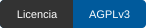

# Fisgón — Captura e inferencia en el equipo local

Componente **edge** del Proyecto Final de Ingeniería Fisgón: un sistema de detección de pistolas y cuchillos visibles en cámaras CCTV mediante YOLOv8. Este repositorio contiene la aplicación que corre junto a las cámaras, procesa el video y envía eventos confirmados a la API en la nube.

El prototipo está orientado a **Windows, Python 3.12 y GPU AMD con DirectML**. El alcance evaluado es de hasta cuatro cámaras en un equipo. La API, el panel web, el entrenamiento del modelo y la infraestructura se mantienen en repositorios separados.

## Qué hace

1. Captura video de cámaras RTSP o una webcam mediante OpenCV y reconecta las fuentes cuando se interrumpen.
2. Selecciona cuadros según los FPS configurados y aplica un filtro de movimiento con observación periódica en reposo.
3. Ejecuta YOLOv8 exportado a ONNX, con una sesión de inferencia compartida y procesamiento por lotes.
4. Valida las detecciones en una ventana temporal antes de confirmar un evento.
5. Guarda los eventos en SQLite y prepara clips con contexto anterior y posterior a la detección.
6. Envía la captura y los metadatos a la API; adjunta el video después y reintenta los envíos pendientes.

También consulta el cupo de cámaras del dispositivo, envía un pulso de vida a la API y ofrece una interfaz web local para configurar cámaras y parámetros. `run.py` supervisa el pipeline y el panel, y reinicia el pipeline al guardar cambios de configuración.

## Tecnologías

| Tecnología | Uso |
|------------|-----|
| Python 3.12 | Aplicación, hilos de trabajo y supervisión de procesos |
| OpenCV y NumPy | Captura, tratamiento de cuadros y generación de clips |
| Ultralytics YOLOv8 | Modelo de detección y exportación a ONNX |
| ONNX Runtime DirectML | Inferencia acelerada en la GPU AMD |
| SQLite | Buffer persistente de eventos y reintentos |
| PyYAML y python-dotenv | Configuración de cámaras y credenciales de la API |
| Requests | Comunicación HTTPS con el backend |
| `http.server`, HTML y CSS | Panel de configuración local |
| pytest | Pruebas de validación, colas, persistencia y comunicación |

Las versiones utilizadas están fijadas en [requirements.txt](requirements.txt). La instalación y el orden de las dependencias se explican en [INSTALACION.md](INSTALACION.md).

## Estructura

```text
capture/          Captura por cámara, reconexión y cola de cuadros
inference/        Carga del modelo y worker de inferencia
events/           Validación temporal, buffer SQLite y clips de video
upload/           Envío de eventos, consulta de cupo y pulso de vida
config_ui/        Panel web local y recursos estáticos
models/           Pesos del modelo, incluido best.onnx
benchmarks/       Mediciones de rendimiento y resultados
tests/            Pruebas automatizadas
main.py           Punto de entrada del pipeline
run.py            Inicio y supervisión del pipeline y del panel
cameras.yaml      Cámaras y parámetros de procesamiento
instalar.ps1      Instalación y verificación de DirectML en Windows
```

## Instalación y ejecución

Necesitás Windows, Python 3.12, los controladores de la GPU y acceso a las cámaras y a la API. Seguí [INSTALACION.md](INSTALACION.md) para preparar la máquina y verificar que el modelo use `DmlExecutionProvider`.

Desde la raíz del repositorio, en PowerShell:

```powershell
.\instalar.ps1
```

Colocá el modelo en `models/best.onnx` y configurá las cámaras en `cameras.yaml`. Las credenciales de la API se guardan en un archivo `.env` local:

```dotenv
FISGON_API_URL=https://tu-api.example.com
FISGON_EDGE_TOKEN=token-asignado-a-este-dispositivo
```

Para iniciar el sistema completo:

```powershell
.\venv\Scripts\python.exe run.py --config cameras.yaml
```

El panel se abre en `http://localhost:8000`. Permite configurar cámaras, probar conexiones y editar parámetros de inferencia. En el primer ingreso, cambiá la contraseña inicial desde **Perfil**. `Ctrl+C` detiene los procesos.

Para ejecutar únicamente el pipeline:

```powershell
.\venv\Scripts\python.exe run.py --config cameras.yaml --sin-ui
```

## Pruebas y documentación

Con el entorno instalado, las pruebas se ejecutan desde la raíz:

```powershell
.\venv\Scripts\python.exe -m pip install -r requirements-dev.txt
.\venv\Scripts\python.exe -m pytest -v
```

- [INSTALACION.md](INSTALACION.md): preparación de la máquina, credenciales, arranque y problemas conocidos.
- [SISTEMA.md](SISTEMA.md): funcionamiento del pipeline y decisiones técnicas.
- [CUPO_CAMARAS_BACKEND.md](CUPO_CAMARAS_BACKEND.md): contrato de cupo de cámaras con la API.
- [PULSO_VIDA_BACKEND.md](PULSO_VIDA_BACKEND.md): contrato de monitoreo del dispositivo y las cámaras.

---

## Licencia

El código original del componente edge se distribuye bajo la [GNU Affero General Public License, versión 3](LICENSES/AGPL-3.0-only.txt) (`AGPL-3.0-only`). Permite su uso, modificación y redistribución, también comercial, respetando sus condiciones de conservación de avisos y acceso al código fuente. Si ofrecés una versión modificada a usuarios por red, debe ofrecerles acceso a su código fuente correspondiente según la licencia.

[](LICENSES/AGPL-3.0-only.txt)

La documentación original se distribuye bajo [Creative Commons Atribución-CompartirIgual 4.0 Internacional](https://creativecommons.org/licenses/by-sa/4.0/deed.es), con atribución, indicación de cambios y CompartirIgual.

[](https://creativecommons.org/licenses/by-sa/4.0/deed.es)

Consultá el [alcance, las exclusiones y los avisos de terceros](LICENSE.md).

## Créditos


Proyecto académico PFI Fisgón — detección de armas con YOLO. Este repositorio contiene el componente de captura e inferencia local. Consultá el historial de git para contribuciones y evolución del sistema.
